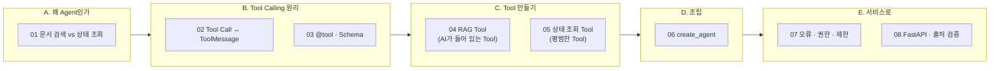
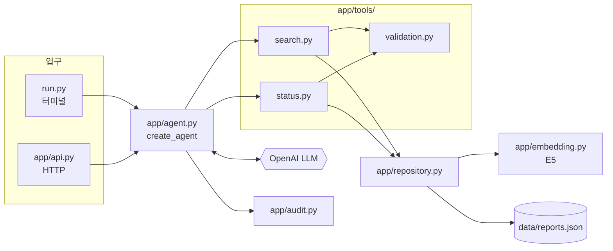
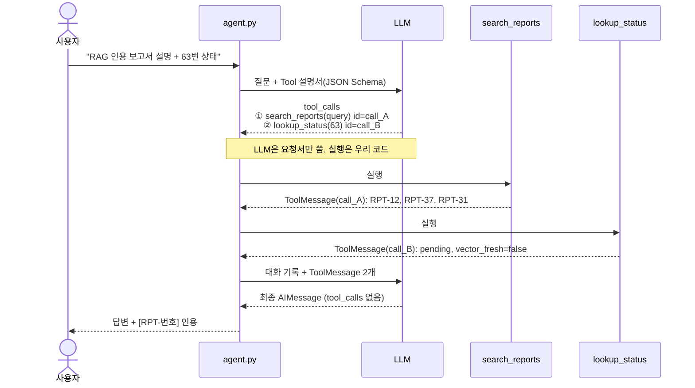
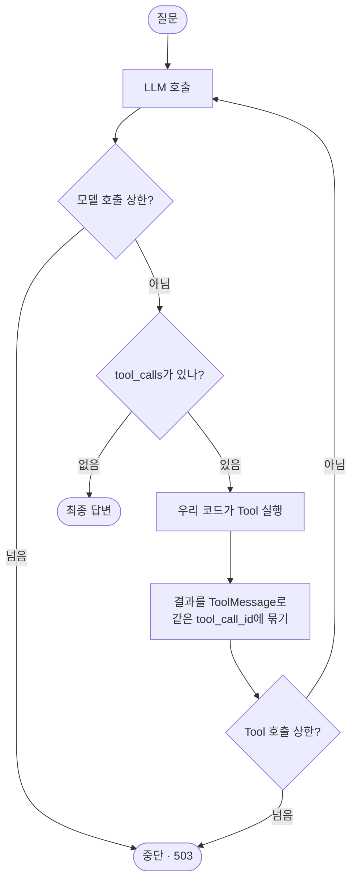
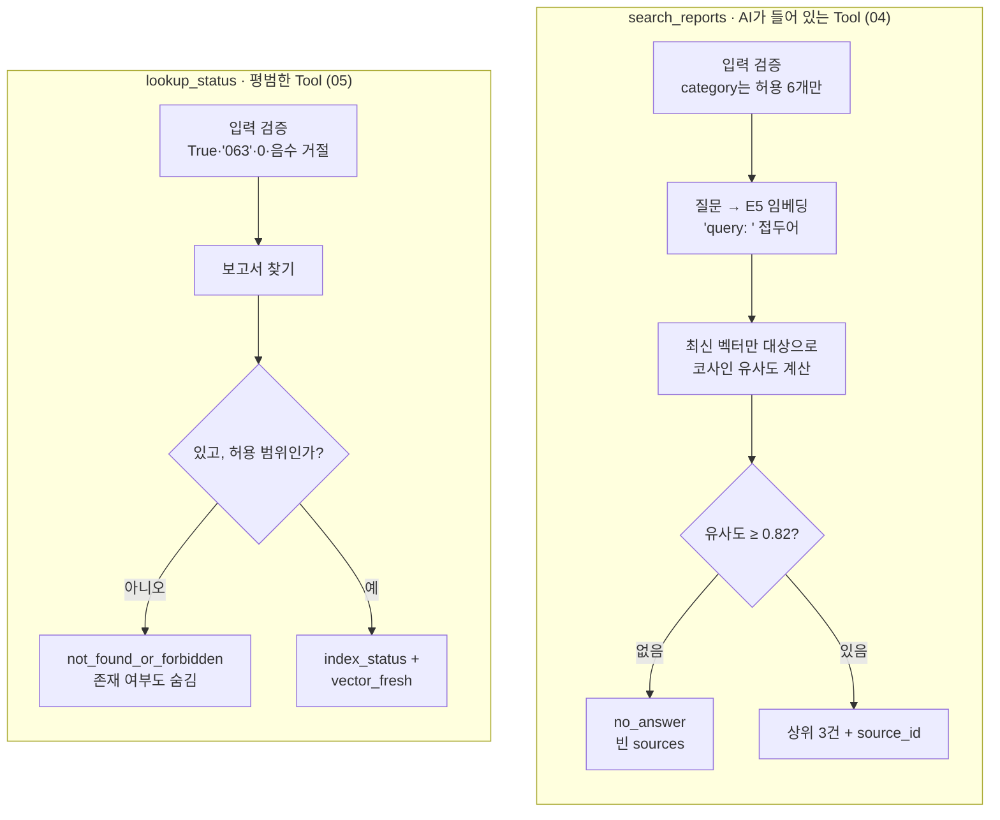

# 04_fit · Day29(11/26) 수업 전체를 한 프로젝트로

오늘 수업 01~08을 **실제 서비스 모양의 작은 프로젝트 하나**로 다시 묶었습니다.

- **오늘의 그림:** 11/20에 만든 RAG(AI 검색)와 DB 조회를 **Tool**로 감싸고, **LLM Agent**가 질문에 맞게 골라 쓰게 한 뒤, 안전장치를 달아 **API**로 내놓습니다.
- DB 없이 합성 데이터 12건(`data/reports.json`)으로 동작합니다. 검색은 진짜 E5 임베딩입니다(GPU가 있으면 GPU 사용).
- LangChain(`@tool`, `create_agent`)이 코드에 그대로 보입니다. `coursekit`은 쓰지 않습니다.
- 필요한 설정은 `.env`의 `OPENAI_API_KEY`, `LLM_MODEL` 두 개뿐입니다.

---

## 1. 오늘 수업 지도



| 주제 | 실습 | 이 폴더에서 보는 곳 |
|---|---|---|
| A | 01 | `app/tools/`의 Tool 두 개, `run.py` 출력에서 LLM이 질문에 따라 둘 다/하나만 고르는 장면 |
| B | 02 | `run.py` 출력의 `id` = `tool_call_id`, 부록의 `"role": "tool"` |
| B | 03 | `app/tools/search.py`, `status.py`의 `@tool`·docstring·`Field(description=...)` ↔ 부록의 손으로 쓴 `TOOL_SCHEMAS` |
| C | 04 | `app/embedding.py`(E5), `app/repository.py`의 `search_reports()`(유사도 기준, 최신 벡터만 검색) |
| C | 05 | `app/tools/status.py`의 `vector_fresh`, 범위 밖 보고서 숨기기 |
| D | 06 | `app/agent.py`의 `create_agent`, `summarize()`(모델 호출 수·Tool 실행 수·최종 답변 따로 집계) |
| E | 07 | `app/tools/validation.py`(조회 전 차단), `app/errors.py`(오류 구분), `agent.py`의 호출 상한 2개, `app/audit.py`(안전한 로그) |
| E | 08 | `app/api.py`의 `POST /api/agent/ask`, 인용 출처 검증(실패 시 502) |

## 2. 폴더 구조

```
04_fit/
├─ README.md
├─ .env / .env.example       OPENAI_API_KEY, LLM_MODEL
├─ data/
│   └─ reports.json          합성 보고서 12건
├─ app/
│   ├─ config.py             ① 설정: .env + 앱 정책 값(유사도 기준, 허용 카테고리, 호출 상한)
│   ├─ embedding.py          E5 임베딩 + 코사인 유사도 (pgvector 역할)
│   ├─ repository.py         ② 데이터: 의미 검색, 보고서 조회, 벡터 최신 여부
│   ├─ errors.py             오류 구분: 사용자 입력 오류 / 시스템 오류
│   ├─ tools/                ③ Tool (LLM에게 공개하는 기능)
│   │   ├─ __init__.py          TOOLS = [search_reports, lookup_status]  ← 등록부
│   │   ├─ search.py            search_reports (AI가 들어 있는 Tool)
│   │   ├─ status.py            lookup_status (평범한 Tool)
│   │   └─ validation.py        두 Tool이 같이 쓰는 입력 검증
│   ├─ agent.py              ④ Agent: create_agent + 호출 상한 + 실행 결과 집계
│   ├─ audit.py              안전한 실행 로그 → logs/audit.jsonl
│   └─ api.py                ⑤ 입구(HTTP): POST /api/agent/ask + 출처 검증
├─ run.py                    입구(터미널): 메시지 흐름 전체 + 요약 출력
└─ appendix_raw_loop.py      부록: LangChain 없이 같은 흐름을 직접 짠 버전
```

## 3. 파일끼리의 관계



- 화살표는 "부른다"는 뜻입니다. **아래쪽은 위쪽을 모릅니다.** `repository.py`는 Agent가 있는지조차 모릅니다.
- 입구가 두 개여도 Agent는 하나입니다.
- 실제 PostgreSQL로 바꾸려면 `repository.py`(와 `embedding.py`) 안쪽만 바꾸면 됩니다.

## 4. 질문 하나가 처리되는 순서



`create_agent`가 대신 해 주는 일은 이 그림의 **반복**입니다. 이 반복문을 손으로 짠 것이 `appendix_raw_loop.py`의 `while True:`입니다.



## 5. Tool 두 개의 안쪽

Agent 입장에서는 둘 다 "이름 + 설명서 + 입력 → JSON 결과"일 뿐입니다. 안쪽은 전혀 다릅니다.



**`vector_fresh`가 왜 필요한가 (05):** `index_status`가 `ready`여도 보고서가 수정돼(`revision 2`) 벡터가 옛 버전(`indexed_revision 1`)이면 검색 결과를 믿을 수 없습니다. 50번 보고서가 그 예입니다. 그래서 검색 대상은 `ready` **이고** `indexed_revision == revision`인 보고서만입니다(수업 SQL의 조건과 같음).

## 6. 수업 자료와 04_fit의 설계 차이

| | 수업 자료 (mentee/mentor) | 04_fit |
|---|---|---|
| 데이터 | 11/20 PostgreSQL `report_agent_lab` | 합성 JSON 12건 |
| 검색 | E5(GPU) + pgvector + Reranker(GPU) | E5 + 메모리 코사인 계산, Reranker 없음 |
| RAG Tool 안의 LLM | **있음**: Tool 안에서 LLM이 근거로 답변을 한 번 쓰고, Agent의 LLM이 또 씀 | **없음**: Tool은 문서만 돌려주고 답변은 Agent의 LLM이 한 번만 씀 |
| LangChain | `coursekit` 안에 감춰짐 | 각 파일에 그대로 보임 |
| 범위 제한 | `ALLOWED_CATEGORIES` | 같음 (HR 카테고리 78번을 숨김) |

**Tool 안에 LLM을 두는 방식의 장단점**
- 장점: 11/20에 만든 RAG(`rag_answer`)를 그대로 재사용합니다. Tool이 "답변 + 출처"를 완성해서 돌려줍니다.
- 단점: LLM 호출이 2배(비용·시간), 지어낼 수 있는 곳도 2곳입니다. Agent의 LLM은 근거 원문이 아니라 요약된 답을 받습니다.
- 04_fit은 Tool이 원문을 그대로 돌려주는 쪽(실무에서 더 흔한 방식)을 택했습니다.

## 7. 실행 방법

공용 가상환경을 켜고 `04_fit` 폴더에서 실행합니다. 첫 실행 때 E5 모델을 불러오느라 몇 초 걸립니다.

```powershell
cd C:\workspace\practice_assignment\20261126\04_fit
..\..\envs\.venv\Scripts\Activate.ps1

python run.py                                    # 기본 질문
python run.py "출처 정밀도를 높인 실험이 있었어?"    # 질문 바꾸기
python appendix_raw_loop.py                      # LangChain 없는 버전과 비교

uvicorn app.api:app --port 8008                  # API → http://127.0.0.1:8008/docs
```

`run.py` 실제 출력 (요약):

```
[Human] RAG 근거 인용 정확도 향상과 관련된 보고서의 내용을 설명하고, 보고서 63번의 인덱싱 상태도 알려줘.

[AI → Tool 요청]  (LLM은 요청서만 쓴다. 실행은 아직 안 됨)
   id=call_8vPR...  search_reports({'query': 'RAG 근거 인용 정확도 향상', 'category': 'ALL'})
   id=call_hAz9...  lookup_status({'report_id': 63})

[Tool 실행 결과]  (우리 코드가 실행)  tool_call_id=call_8vPR...
   search_reports → {"status": "ok", "sources": [{"source_id": "RPT-12", ..., "similarity": 0.92}, ...

[Tool 실행 결과]  (우리 코드가 실행)  tool_call_id=call_hAz9...
   lookup_status → {"status": "ok", "report_id": 63, ..., "index_status": "pending", "vector_fresh": false}

[AI 최종 답변]
... 인용 정확도가 72%에서 91%로 올랐다는 내용이 있습니다 ... [RPT-12] [RPT-37] [RPT-31]
보고서 63번은 pending입니다.

[요약] 모델 호출 2회 · Tool 실행 2회 · 근거 ['RPT-12', 'RPT-31', 'RPT-37'] · 상태 조회 ['RPT-63']
```

API로 여러 질문을 보낸 실제 결과:

| 질문 | 고른 Tool | 결과 |
|---|---|---|
| RAG 인용 보고서 설명 + 63번 상태 | 둘 다 | 200, `[RPT-12]` 인용 + "63번은 pending" |
| 출처 정밀도를 높인 실험이 있었어? | search | 200, 단어가 달라도 RPT-12를 찾음 (의미 검색) |
| 점심 메뉴 관련 보고서 있어? | search | 200, 기준 미달 → "찾을 수 없습니다" (지어내지 않음) |
| 보고서 50번은 검색에 쓸 수 있는 상태야? | status | 200, "ready지만 vector_fresh는 false" |
| 보고서 063번 상태 알려줘 | status | 200, 입력 오류 이유를 그대로 안내 |
| 78번 보고서 상태는? | status | 200, "찾을 수 없습니다" (HR 범위 밖, 존재 여부 숨김) |
| 빈 질문 | - | 422 |
| (가짜 응답) 검색 근거에 없는 `[RPT-63]` 인용 | - | 502 |
| (가짜 응답) 호출 상한 초과 | - | 503 |

`logs/audit.jsonl`에는 질문 원문 없이 이런 줄만 남습니다.
```json
{"time": "2026-11-26T13:59:55", "ok": true, "question_length": 58, "model_calls": 2, "tools": ["search_reports", "lookup_status"], "elapsed_sec": 3.11, "error_type": null}
```

## 8. 직접 해 보면 좋은 것

1. **Schema 보기 (03):** LLM이 실제로 받는 설명서를 출력합니다.
   ```powershell
   python -c "from app.tools import lookup_status; print(lookup_status.args_schema.model_json_schema())"
   ```
2. **docstring 망가뜨리기 (03):** `app/tools/search.py`의 docstring을 `"아무 기능"`으로 바꾸고 `run.py`를 실행합니다. LLM이 Tool을 잘 못 고르게 됩니다.
3. **유사도 기준 바꾸기 (04):** `config.py`의 `MIN_SIMILARITY`를 0.78로 내리고 "점심 메뉴"를 다시 물어 봅니다. 엉뚱한 보고서가 근거로 딸려 옵니다. E5 점수는 0.78~0.92에 몰려 있어서 기준값만으로 거르기에는 한계가 있습니다. 수업 자료가 Reranker를 쓰는 이유입니다.
4. **범위 제한 (05):** `ALLOWED_CATEGORIES`에서 `"EXPERIMENT"`를 빼고 기본 질문을 다시 실행합니다. RPT-12가 사라집니다.
5. **Tool 추가하기 (03·06):** "카테고리별 보고서 개수" Tool을 `app/tools/count.py`로 만들고 `app/tools/__init__.py`의 `TOOLS`에 한 줄 추가합니다. `agent.py`는 고칠 필요가 없습니다.
6. **출처 검증 (08):** 시스템 프롬프트에서 "[RPT-번호]로 인용하지 마세요" 줄을 지우고 API로 기본 질문을 보내 봅니다. LLM이 `[RPT-63]`을 인용하면 502로 막힙니다. 63번은 상태를 조회했을 뿐 내용 근거가 아니기 때문입니다.

## 9. 자가 점검: 보지 않고 답할 수 있으면 오늘 내용을 배운 것

1. LLM이 DB를 직접 조회하지 않고 "요청서"만 쓰는 구조에서 우리가 얻는 것은 무엇인가? (검증, 권한, 제한을 우리 코드가 건다)
2. `tool_call_id`가 없으면 Tool을 여러 개 동시에 부를 때 무슨 문제가 생기는가?
3. LLM은 Tool을 고를 때 무엇을 보는가? docstring을 대충 쓰면 어떻게 되는가?
4. `search_reports`와 `lookup_status`는 Agent 입장에서 무엇이 같고, 안쪽은 무엇이 다른가?
5. `index_status`가 `ready`인데 검색에 쓰면 안 되는 경우는 언제인가?
6. 사용자 입력 오류와 시스템 오류를 왜 다르게 응답하는가? 로그에 질문 원문을 남기지 않는 이유는?
7. 답변이 `[RPT-63]`을 인용했는데 63번이 검색 근거가 아니라 상태 조회 대상이었다면 왜 실패로 처리해야 하는가?
8. 새 Tool을 추가하려면 어느 파일을 고치는가? 왜 `agent.py`는 안 고쳐도 되는가?
